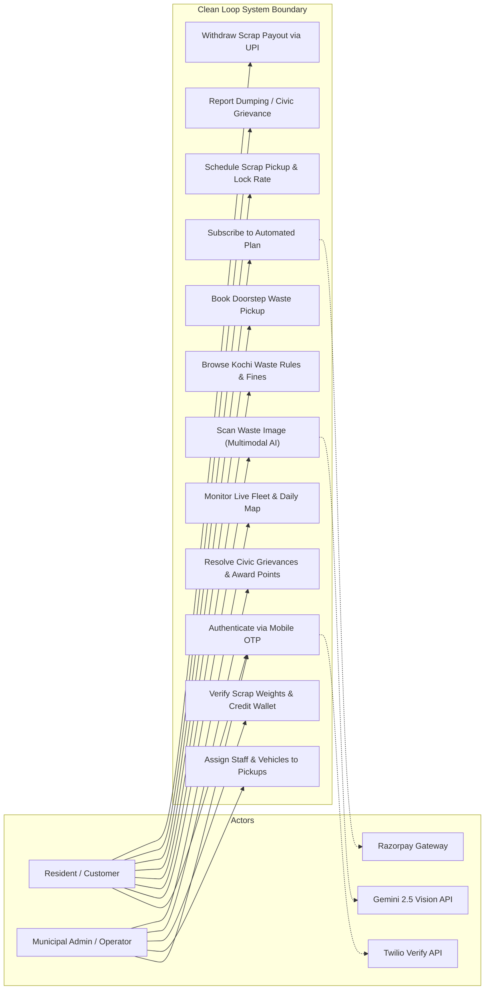
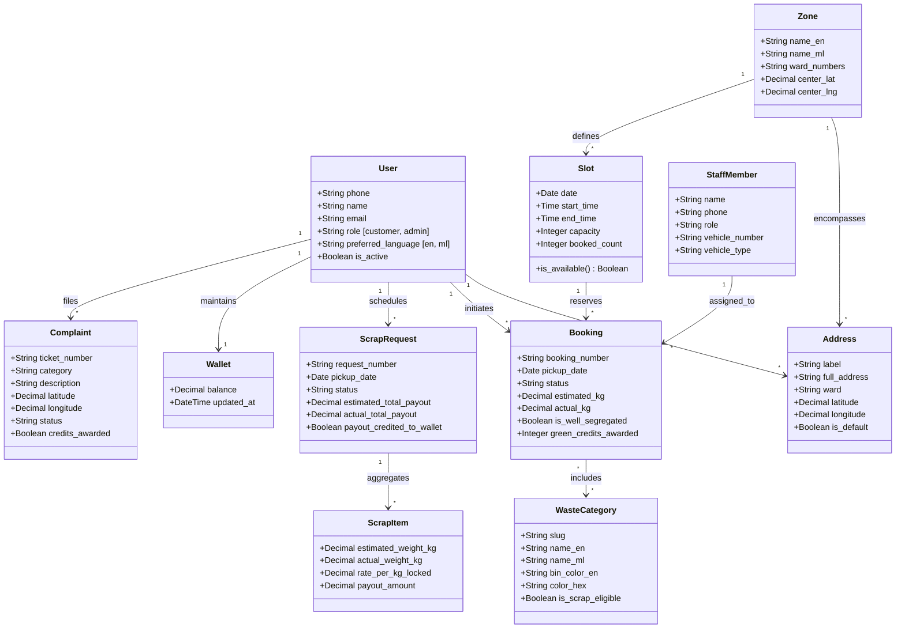
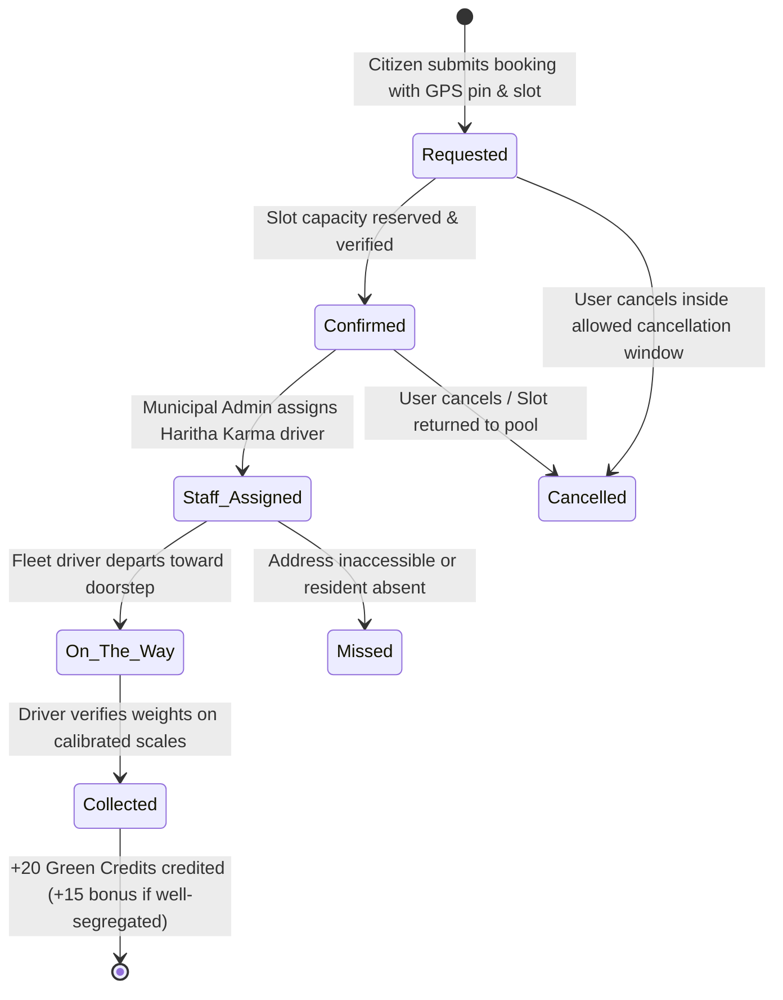
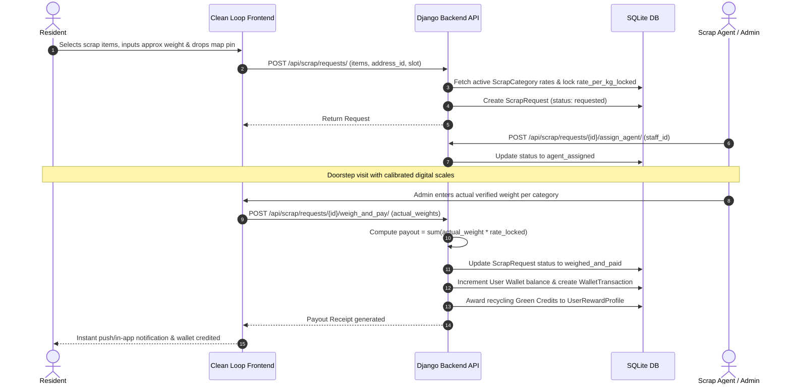

# Clean Loop: Analysis and Requirements Specification Report
**Project Name:** Clean Loop (ക്ലീൻ ലൂപ്പ്)  
**Domain:** Municipal Solid Waste Management & Informal Scrap Recycling Platform  
**Target Locale:** Kochi Municipal Corporation & Greater Cochin Metropolitan Area, Kerala, India  
**Date:** October 25, 2026  
**Document Version:** 1.0 (Final Architecture & Engineering Release)

---

## 1. Executive Summary & Problem Analysis

### 1.1 Problem Context in Kochi, Kerala
Kochi generates in excess of **300 to 350 metric tonnes of municipal solid waste per day**, of which roughly **65% to 70% is biodegradable organic matter** and the remainder consists of recyclable polymers, packaging film, glass, metal scrap, construction debris, and e-waste. Despite extensive door-to-door initiatives orchestrated under the State of Kerala's **Suchitwa Mission** and municipal **Haritha Karma Sena (HKS)** self-help collectives, urban waste management continues to suffer from four persistent bottlenecks:

1. **Source Segregation Deficits & Cognitive Load:**  
   Residents struggle to distinguish between recyclable dry polymers and hazardous multi-layered packaging or biomedical sanitary items. Consequently, mixed refuse ends up at legacy collection dumps or is improperly incinerated.
2. **Informal and Inefficient Scrap Monetization:**  
   Doorstep scrap collectors operate without standardized digital weight scales or live benchmark pricing. Households routinely accumulate unsegregated paper, metal wiring, and packaging cartons until forced to dump them because booking a certified recycler is inconvenient.
3. **Fragmented Municipal Enforcement & Information Asymmetry:**  
   Kochi Municipal Corporation (KMC) has instituted stringent bye-laws against open dumping, leaf burning, and banned single-use plastics (<120 microns). However, residents often lack direct access to localized penalty schedules or timely channels for reporting illegal dumping blackspots.
4. **Lack of Positive Reinforcement:**  
   Traditional collection systems do not provide individual accountability or environmental feedback. Residents have no visibility into the carbon footprint saved or tangible incentives for adhering to strict segregation guidelines.

### 1.2 The Clean Loop Solution
**Clean Loop** is an integrated full-stack cyber-physical waste orchestration platform engineered specifically for Kochi city. It provides:
- **Bilingual Accessibility:** Native English and Malayalam (`മലയാളം`) interface with persistent locale preference.
- **Multimodal AI Waste Classification:** Cloud-powered computer vision (Google Gemini 2.5 Flash) allowing residents to photograph items and receive immediate, schema-validated bin designations, segregation steps, and scrap eligibility.
- **Doorstep Scheduling & Route Capacity Throttling:** Strict ward-level capacity slots that prevent fleet overloading.
- **Fair-Market Scrap Buying & Digital Wallet:** Locked wholesale scrap rate cards, doorstep weighing on digital calibrated scales, instant in-app wallet balance credit, and simulated/live UPI withdrawal.
- **Closed-Loop Civic Grievance System:** Geotagged dumping reporting with Leaflet map pins, municipal review workflows, and Green Credit incentives.
- **Personalized Carbon Accounting:** Verified CO2 avoidance calculations based on Kerala-specific conversion factors ($1.85 \text{ kg } \text{CO}_2/\text{kg recycled}$).

---

## 2. UML Analysis Models

To systematically conceptualize the operational actors, domain relationships, behavioral lifecycles, and transaction flows, the following UML analysis models govern the Clean Loop ecosystem.

### 2.1 Use Case Model
The system defines two primary human actors: **Resident (Customer)** and **Municipal Admin / Fleet Operator**. External boundary systems include the **Twilio SMS Gateway**, **Razorpay Payment Engine**, and **Google Gemini Vision API**.



---

### 2.2 Domain Class Model (Structural Analysis)
The domain entities represent the core business logic, bilingual attributes, and relational constraints implemented across the Django REST backend.



---

### 2.3 Behavioral Model: Booking Lifecycle State Diagram



---

### 2.4 Transactional Model: Doorstep Scrap Collection & Wallet Payout (Sequence Diagram)



---

## 3. System-Level Requirements (SLR)

System-level requirements encapsulate operational, environment, platform-wide boundary conditions, and external system integrations.

| ID | Requirement Statement | Priority | Verification Method |
|:---|:---|:---:|:---:|
| **SLR-01** | The platform shall maintain high operational availability on standard consumer and municipal hardware across both desktop and mobile client browsers without requiring native binary app store installations. | High | Automated Browser Testing |
| **SLR-02** | The platform shall operate without hard dependency on commercial paid mapping APIs by utilizing OpenStreetMap cartographic tile layers and public Nominatim reverse-geocoding endpoints adhering strictly to rate limits (maximum 1 req/sec with client-side debouncing). | High | Network Inspection |
| **SLR-03** | The system shall isolate and execute all AI inference calls exclusively on the backend server. No Gemini API tokens, Twilio Auth Tokens, or Razorpay Secret Keys shall ever be packaged, rendered, or exposed to the client bundle. | Critical | Static Security Audit |
| **SLR-04** | The platform shall feature a dual-language architecture supporting English and Malayalam (`മലയാളം`) across all navigational labels, static educational content, database domain entries, and AI agent output. User language preferences must persist locally across browser sessions. | High | Localization Inspection |
| **SLR-05** | The backend architecture shall support decoupled sandbox execution via an explicit environment configuration variable (`OTP_DEV_MODE=True`), enabling offline automated unit tests, demonstration walkthroughs, and development cycles without external SMS gateway egress. | Critical | Automated Unit Tests |
| **SLR-06** | The platform shall enforce zero data-loss transactions for scrap sales by permanently locking the unit rate (`rate_per_kg_locked`) at request time, ensuring historical payouts remain unaffected by subsequent market price fluctuations. | High | DB Transaction Test |

---

## 4. Software-Level Requirements (SR)

Software-level requirements define functional rules, user interactions, database integrity constraints, and algorithmic routines.

### 4.1 Functional Requirements (FR)

#### FR-01: Authentication & Identity Management
- **FR-01.1:** The backend shall validate all incoming phone strings against the E.164-compatible Indian mobile pattern: `^\+91[6-9]\d{9}$`.
- **FR-01.2:** On OTP request, the system shall throttle requests to a maximum of 5 attempts per phone number per 10-minute window to mitigate SMS flooding and abuse.
- **FR-01.3:** Upon successful OTP verification, the backend shall issue standard SimpleJWT access (1-day validity) and refresh (30-day validity) tokens.
- **FR-01.4:** On sign-out, the client refresh token shall be posted to `/api/accounts/auth/signout/` and inserted into Django's `OutstandingToken` / `BlacklistedToken` registry.

#### FR-02: Waste Segregation & Educational Intelligence
- **FR-02.1:** The system shall expose searchable, filterable categories including Food/Wet Organic, Dry Recyclables, Plastic Packaging, Glass, E-Waste, Biomedical/Sanitary, Hazardous Chemicals, and Garden Biomass.
- **FR-02.2:** Each category entity shall contain structured fields for: what it is, designated bin color, do's, don'ts, authorized collector, and preparation guidelines in both English and Malayalam.
- **FR-02.3:** The Rules and Fines module shall display indicative penalties under Kochi Municipal Corporation bye-laws with a visible statutory disclaimer banner: *"Indicative information. Verify current rules and fines with Kochi Municipal Corporation / Kerala LSGD."*
- **FR-02.4:** A Plain-Language Rules Q&A assistant shall answer user queries by grounding responses strictly within verified database records.

#### FR-03: Doorstep Waste Collection Booking & Quota Slots
- **FR-03.1:** Residents shall be capable of creating one-time collection bookings selecting waste categories, specifying estimated quantity (kg), dropping a map pin, and choosing an active date slot.
- **FR-03.2:** The slot booking service shall enforce hard capacity limits per zone per time window. If `booked_count >= capacity`, the slot shall immediately render unavailable in the UI and reject incoming POST requests.
- **FR-03.3:** Subscriptions shall support Daily, Monthly, and Yearly tiers with automatic scheduled pickup generation for a minimum 14-day rolling window.

#### FR-04: Scrap Collection, Digital Weighing & Payout Wallet
- **FR-04.1:** The system shall maintain an admin-editable wholesale Scrap Rate Card with timestamped historical audit logs (`ScrapRateHistory`).
- **FR-04.2:** On scrap pickup, the assigned staff/admin shall record the actual scale weight per category item. The system shall compute total payout according to the formula:
  $$\text{Payout}_{\text{total}} = \sum_{i=1}^{n} (\text{ActualWeight}_{i} \times \text{RateLocked}_{i})$$
- **FR-04.3:** The calculated payout shall be automatically credited to the resident's in-app `Wallet`, recording an immutable `WalletTransaction` entry.
- **FR-04.4:** Residents shall be permitted to submit UPI/bank withdrawal requests for any amount less than or equal to their available wallet balance.

#### FR-05: Server-Side AI Intelligence (Google Gemini 2.5)
- **FR-05.1:** Image classification requests (`/api/ai/identify-waste/`) shall accept JPEG/PNG payloads up to 8MB, invoking Gemini 2.5 Flash with structured JSON schema output:
  ```json
  {
    "item_name": "string",
    "waste_category": "string",
    "bin_color": "string",
    "is_recyclable": true,
    "is_scrap_eligible": true,
    "disposal_steps": ["step1", "step2", "step3"],
    "confidence_score": 0.95,
    "note": "string"
  }
  ```
- **FR-05.2:** If the Gemini API key is missing or quota is exhausted, the service layer must fall back gracefully to offline Kerala-grounded knowledge tables without crashing or returning HTTP 500 errors.

#### FR-06: Civic Grievance Reporting & Green Credits
- **FR-06.1:** Citizens shall be able to report illegal dumping blackspots, missed collections, or waste burning with photographic proof, description, and pinpointed coordinates.
- **FR-06.2:** When a municipal operator marks a grievance as `Resolved`, the system shall award **+25 Green Credits** to the reporter.
- **FR-06.3:** The system shall allow residents to redeem Green Credits for wallet credits at a configurable conversion rate (100 credits = ₹25.00).

---

### 4.2 Non-Functional Requirements (NFR)

| Category | Requirement Specification | Metrics & Criteria |
|:---|:---|:---|
| **Performance** | API endpoint latency for standard CRUD operations must remain below 150 ms under concurrent load. AI multimodal inference roundtrip must complete within 2.5 seconds over standard 4G broadband. | $t_{\text{CRUD}} \le 150\text{ ms}$, $t_{\text{AI}} \le 2500\text{ ms}$ |
| **Security** | Authentication tokens must use cryptographically signed HMAC SHA256 hashes. All user passwords/tokens must be non-recoverable. Payment verification must enforce server-side HMAC validation of `razorpay_order_id` and `razorpay_payment_id`. | Zero secret leakage; SHA-256 HMAC parity |
| **Reliability** | The client single-page application must gracefully handle intermittent connectivity loss during map dragging or reverse geocoding via local memory caching and state recovery. | Zero application crashes on network timeout |
| **Accessibility & Usability** | The web UI must adhere to WCAG 2.1 Level AA standards, featuring high-contrast color pairings, explicit form labels, ARIA landmarks, minimum 44px tap targets on mobile screens, and full responsive support down to 320px viewport width. | Lighthouse Accessibility score $\ge 92$ |
| **Data Integrity** | SQLite foreign key enforcement (`PRAGMA foreign_keys = ON`) and ACID transaction boundaries (`@transaction.atomic`) must wrap all simultaneous multi-table state transitions (e.g., weighing scrap, creating wallet credits, and awarding points). | Atomic rollback on partial failure |

---

## 5. Requirements Traceability Matrix (RTM)

The following matrix guarantees that all identified urban waste management challenges map to concrete architectural components, database models, and test verifications:

| Problem Domain Need | System Requirement | Implementing Backend App / Frontend View | Automated Test Verification |
|:---|:---|:---|:---|
| Source Segregation Errors | FR-02.1, FR-05.1 | `waste_info` / `WasteGuidePage.jsx`, `gemini_service.py` | Multimodal schema validation test |
| Doorstep Fleet Overload | FR-03.2 | `waste_collections` / `BookPickupPage.jsx` | `test_booking_slot_capacity_constraint` |
| Scrap Collector Exploitation | FR-04.1, FR-04.2 | `scrap` / `SellScrapPage.jsx`, `WalletPage.jsx` | `test_scrap_payout_and_wallet_credit` |
| Illegal Dumping Inaction | FR-06.1, FR-06.2 | `complaints` / `ComplaintsPage.jsx`, `AdminDashboard.jsx` | Complaint status transition test |
| Unverified Rule Ambiguity | FR-02.3, FR-02.4 | `waste_info` / `RulesFinesPage.jsx` | Rules search filter & Q&A test |
| Recurring Collection Needs | FR-03.3 | `subscriptions` / `SubscriptionsPage.jsx` | `test_subscription_creation_and_scheduled_pickups` |

---

*Clean Loop Architecture Team — Kochi Urban Environmental Technology Group.*
