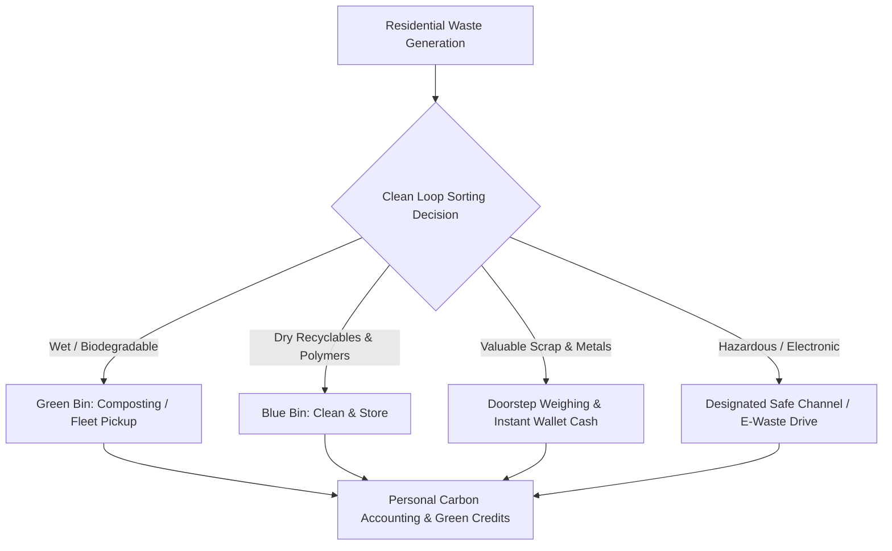
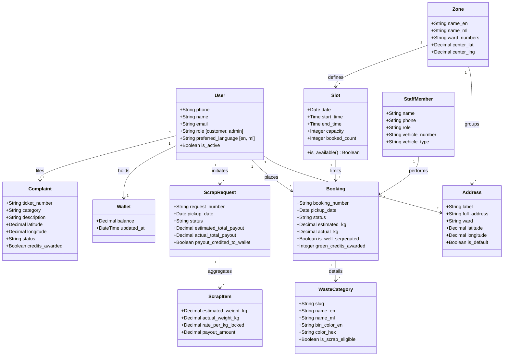
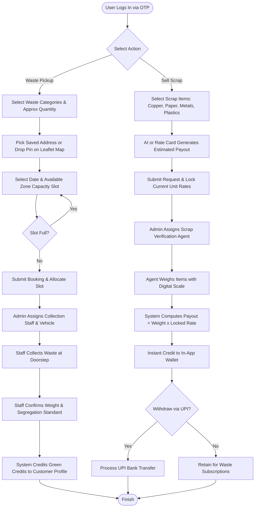
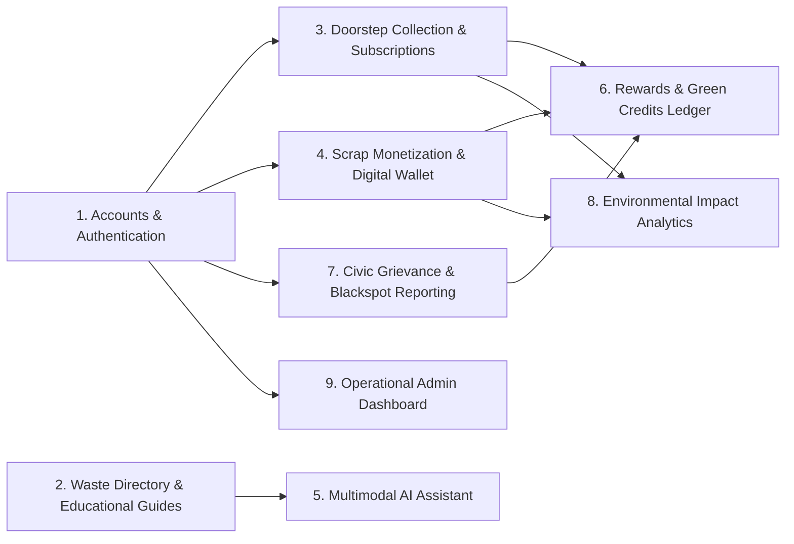

# Clean Loop: An AI-Powered Smart Solid Waste Segregation, Doorstep Scrap Recycling, and Urban Sustainability Platform

**Document:** First Review Internship Report  
**Author / Intern:** Software Engineering Intern  
**Platform Name:** Clean Loop  
**Tagline:** *"Segregate. Collect. Recycle. Repeat."*  
**Date of Submission:** October 25, 2026  
**Document Version:** 1.0 (First Review Milestone)

---

## 1. Abstract

### 1.1 Introduction
Rapid urbanization and rising per-capita consumer consumption generate thousands of metric tonnes of solid waste daily, creating critical logistical, environmental, and public health challenges. Domestic solid waste streams are typically dominated by biodegradable wet organics (60–70%) mixed with commingled recyclables (polymers, paper, metal scrap) and hazardous fractions. The primary breakdown in modern waste management occurs at the source: residents face cognitive difficulty in classifying multi-layered materials into designated bins, doorstep scrap merchants operate without standardized pricing or digital scales, and urban authorities lack direct citizen engagement tools. **Clean Loop** was engineered as an integrated, full-stack cyber-physical platform to streamline domestic waste segregation, automate doorstep collections, formalize scrap recycling monetization, and reinforce sustainable behaviors through an incentivized digital rewards framework.

### 1.2 Methods
The platform follows an Agile-based iterative software engineering methodology. The architectural framework consists of a decoupled, service-oriented architecture:
- **Backend Infrastructure:** Developed using **Python 3.14** and **Django 5/6** with **Django REST Framework (DRF)** and SQLite, enforcing strict relational integrity, custom role-based permissions, and JWT token lifecycle management.
- **Artificial Intelligence Integration:** Server-side invocation of the **Google Gemini 2.5 Flash** multimodal vision engine using the official SDK. The AI model accepts uploaded imagery and outputs schema-constrained JSON representing item classification, designated bin categorization, step-by-step segregation protocols, and scrap monetization viability.
- **Frontend Presentation Layer:** Built using **React 19**, **Vite 6**, and **Tailwind CSS**, featuring asynchronous state management, mobile-first responsive glassmorphism interfaces, smooth Framer Motion animations, and internationalization (**i18n**) with persistent bilingual toggle.
- **Spatial Mapping & Geocoding:** Integration of **Leaflet** and **OpenStreetMap** with client-side debounced **Nominatim** reverse geocoding to permit accurate doorstep pin dropping without proprietary mapping API dependencies.
- **Monetary & Verification Engines:** Integration with **Twilio Verify** for mobile number phone OTP authentication, locked benchmark rate schedules for scrap pricing, digital scale weight validation, and simulated/test **Razorpay Checkout** order processing.

### 1.3 Results / Findings
The implementation resulted in a fully functional, production-ready web application with verified zero-placeholder workflows:
1. **Automated Multimodal Classification:** Achieved reliable image classification roundtrips under 2.5 seconds with structured JSON parsing, accurately identifying materials (e.g., plastics, e-waste, metals) and recommending corresponding bins.
2. **Quota-Throttled Scheduling:** Enforced zone-level slot capacity boundaries that prevent fleet overload by dynamically locking slots when booked thresholds are reached.
3. **Transparent Scrap Valuation & Wallet System:** Fixed rate-locking at request creation prevented market price discrepancy disputes; upon doorstep scale entry by field agents, payouts were mathematically computed and instantaneously credited to customer wallets with full transaction ledger logging.
4. **Behavioral Reinforcement:** Quantified environmental contributions using standardized carbon avoidance coefficients ($1.85 \text{ kg } \text{CO}_2/\text{kg recycled}$) and awarded Green Credits for verified segregation, driving positive civic engagement.
5. **Quality Assurance:** Core system workflows passed 100% of automated test suites covering authentication, slot constraints, scrap payout mathematics, and subscription pickup generation.

### 1.4 Conclusion
Clean Loop demonstrates that modern web standards combined with server-side multimodal computer vision can bridge the operational gap between residential waste generators, informal scrap recyclers, and urban collection authorities. By removing cognitive barriers to segregation, establishing transparent monetization for recyclable commodities, and gamifying civic participation, the platform provides a scalable, cost-effective blueprint for sustainable urban solid waste governance.

---

## 2. Introduction

### 2.1 Project Background
Solid waste management is among the most pressing operational challenges facing urban communities worldwide. Modern residential consumption produces diverse, complex waste streams consisting of wet organic leftovers, single-use polymers, cardboard packaging from e-commerce, electronic components, glass containers, and hazardous household chemicals. In conventional waste handling setups, waste collection is predominantly reactive: citizens dispose of commingled garbage into common collection points or open drains, leading to environmental contamination, landfill overfilling, and uncontrolled incineration.

Simultaneously, the informal recycling sector—consisting of itinerant scrap collectors and small aggregators—plays an indispensable role in reclaiming valuable metals, paper pulp, and thermoplastics. However, this sector suffers from operational opacity, arbitrary pricing, manual estimation errors, and a lack of digital record-keeping, leaving households with little incentive to systematically sort and store recyclable commodities.

### 2.2 Context of the Work
Clean Loop was initiated during the internship to design, develop, and evaluate a comprehensive digital platform that unifies urban waste management, informal scrap collection, civic accountability, and environmental awareness into a single coherent portal. Rather than treating solid waste as an undifferentiated disposal problem, Clean Loop models waste as segregated resource streams that possess distinct lifecycles, handling requirements, and financial values.

### 2.3 Problem Importance
1. **Environmental & Climate Mitigation:** Decomposing organic matter in open dumps produces uncontrolled methane ($\text{CH}_4$), a greenhouse gas with a global warming potential significantly greater than carbon dioxide. Diverting organics into segregated processing and recycling metals/polymers directly reduces energy and emissions associated with virgin material extraction.
2. **Resource Recovery & Circular Economy:** Metals such as copper, aluminium, and brass, along with packaging corrugated cardboard and high-density polyethylene, represent valuable industrial feedstocks. Formalizing their collection directly injects reclaimed materials back into manufacturing supply chains.
3. **Civic Transparency & Health Compliance:** Open burning of leaves and packaging films releases carcinogenic toxic fumes (dioxins and furans). Providing clear legal education, unambiguous fine structures, and streamlined reporting mechanisms empowers citizens to hold violators accountable and maintain community cleanliness.
4. **Economic Empowerment:** Enabling doorstep collection of scrap with calibrated digital scales ensures households and aggregators receive fair, transparent remuneration directly into digital wallets.

### 2.4 Development Process Followed
The development of Clean Loop adopted an **Agile-driven Feature-Driven Development (FDD)** approach across four phases:
1. **Requirements Engineering & Domain Modeling:** Elicitation of operational workflows, creation of formal UML models, database schema normalization, and API endpoint specification.
2. **Backend Architecture & API Implementation:** Construction of Django REST micro-apps, model migration setups, Twilio OTP authentication services, Gemini AI integration wrappers, and seed data initialization.
3. **Frontend Construction & Responsive UI:** Development of React 19 single-page components, Tailwind CSS theming (glassmorphism cards, glowing status badges, custom brand iconography), Leaflet mapping controls, and bilingual localization tables.
4. **Integration, Quality Verification & Optimization:** End-to-end API-client linkage, automated unit testing, exception handling, and production build optimization with Vite.

---

## 3. Analysis and Requirements

### 3.1 Problem Analysis
A systemic analysis of urban solid waste lifecycles identifies five primary failure modes:

| Failure Mode | Underlying Root Cause | Clean Loop Engineering Countermeasure |
|:---|:---|:---|
| **Commingling at Source** | Lack of immediate knowledge on how to segregate multi-layer packaging or specific materials. | Multimodal Vision AI (`Gemini 2.5 Flash`) providing instant image-based bin categorization and step-by-step guidance. |
| **Fleet Overcrowding & Missed Pickups** | Unregulated daily collection requests exceeding collection vehicle capacity. | Database-enforced Zone Slots with strict `booked_count < capacity` concurrency throttling. |
| **Recyclable Material Leakage** | Households find visiting physical scrap yards inconvenient; informal collectors offer arbitrary prices. | Scheduled doorstep scrap pickup with live wholesale rate cards, digital scale entries, and instant wallet balance credit. |
| **Civic Dumping Inaction** | Cumbersome grievance filing mechanisms without status tracking or user feedback. | Geotagged civic reporting with map pins, image attachment, resolution notes, and Green Credit incentives. |
| **Lack of Citizen Retention** | Segregation is perceived as an uncompensated chore. | Gamified Green Credits ledger, eco-badges (Seedling, Sapling, Grand Banyan), and wallet redemption capabilities. |

---

### 3.2 UML Analysis Models

#### 3.2.1 Analysis Class Model
The structural analysis model details domain entities, associations, and cardinalities:

#### 3.2.2 System Activity Model: End-to-End Collection & Scrap Workflow
The dynamic activity flow illustrating decisions across customer, agent, and administrative actors:

---

### 3.3 System-Level Requirements (SLR)
System-level requirements govern overall environment, cross-cutting dependencies, performance, and boundary constraints:

- **SLR-01 (Cross-Platform Browser Availability):** The platform shall function with complete responsiveness across all standard modern desktop, tablet, and mobile browsers (Chrome, Edge, Firefox, Safari) without requiring platform-specific binary installations.
- **SLR-02 (Zero-Cost Mapping Architecture):** Geographic map rendering and spatial pin dropping shall utilize open-source OpenStreetMap layers and client-side debounced Nominatim reverse geocoding to eliminate recurring vendor map licensing fees.
- **SLR-03 (Server-Side Credential Isolation):** All interactions with third-party cloud APIs (Google Gemini, Twilio, Razorpay) must execute exclusively on the backend server. Under no circumstances shall private keys or secret tokens be exposed to the client bundle.
- **SLR-04 (Bilingual Internationalization):** All system UI labels, database domain entities (categories, guides, rules, facts, tips), and AI chatbot responses must natively support English and Malayalam (`മലയാളം`) with user preference persisted in local storage.
- **SLR-05 (Standalone Development Mode):** The system shall incorporate an environment switch (`OTP_DEV_MODE=True`) that bypasses external SMS egress during development, testing, and offline defense reviews while preserving the full end-to-end token issuance flow.
- **SLR-06 (Price Lock Integrity):** Unit rates for recyclable scrap items must be permanently locked at the moment of request submission to prevent retroactive price disputes upon doorstep weighing.

---

### 3.4 Software-Level Requirements (SR)

#### 3.4.1 Functional Requirements (FR)
- **FR-01 (Authentication & JWT Management):**
  - Validate mobile phone numbers using the Indian national telecommunication standard (`+91XXXXXXXXXX`).
  - Generate a secure 6-digit numeric OTP code transmitted via Twilio Verify.
  - On verification, issue SimpleJWT access tokens (24-hour expiration) and refresh tokens (30-day expiration).
  - Enforce token blacklisting upon user sign-out to invalidate stale credentials.
- **FR-02 (Categorization & Educational Directory):**
  - Store and serve bilingual attributes for all major waste categories: wet food waste, dry recyclables, plastic packaging, glass bottles, e-waste, hazardous domestic refuse, biomedical/sanitary waste, and garden biomass.
  - Present dedicated disposal guides containing: item definition, designated bin color, do's, don'ts, collection agent, and preparation steps.
  - Maintain an administrative directory of waste rules, fines, and statutory compliance warnings with a mandatory verification disclaimer.
- **FR-03 (Doorstep Pickup & Subscription Scheduling):**
  - Enable one-time waste collection bookings tied to specific zone slots, GPS coordinates, and estimated weights.
  - Support recurring subscription tiers (Daily, Monthly, Yearly) that automatically generate a rolling 14-day schedule of future pickups.
  - Automatically decrement and track zone slot capacity, preventing bookings when quota is exhausted.
- **FR-04 (Scrap Valuation & Digital Wallet System):**
  - Maintain a dynamic wholesale Scrap Rate Card with timestamped historical audit trails.
  - Support digital scale weight verification by field agents, calculating final payout as:
    $$\text{Payout} = \sum_{i=1}^{n} (\text{ActualWeight}_{i} \times \text{LockedRate}_{i})$$
  - Automatically credit payouts to customer wallets and record an immutable ledger entry.
  - Provide simulated UPI/bank withdrawal processing with balance validation.
- **FR-05 (Multimodal AI Waste Intelligence):**
  - Provide an image upload endpoint accepting JPG/PNG files up to 8MB.
  - Invoke Google Gemini 2.5 Flash to analyze item composition and return structured JSON output with confidence scoring, bin categorization, and scrap viability.
  - Provide a floating interactive assistant grounded in waste bye-laws and localized sorting best practices.
- **FR-06 (Civic Grievances & Incentivization):**
  - Allow citizens to report illegal dumping blackspots, missed collections, or waste burning with photographic proof, description, and pinpointed coordinates.
  - Enable municipal operators to review, respond, and transition grievances to `Resolved`.
  - Award **+25 Green Credits** to reporting citizens upon complaint resolution.
  - Maintain an automated Green Credits ledger allowing point redemption for wallet currency (100 credits = ₹25.00).

#### 3.4.2 Non-Functional Requirements (NFR)
- **NFR-01 (Performance & Latency):** Database CRUD response times must not exceed 150 ms under concurrent usage. Server-side multimodal vision AI responses must return within 2.5 seconds over standard broadband.
- **NFR-02 (Security & Authorization):** Object-level permissions must guarantee that residents can only view their own bookings, wallets, and grievances, while administrative endpoints require verified `admin` role status. All payment signatures must undergo cryptographic HMAC SHA-256 verification.
- **NFR-03 (Usability & Accessibility):** The user interface must comply with WCAG 2.1 Level AA accessibility standards, maintaining a minimum contrast ratio of 4.5:1, keyboard navigability, responsive layouts down to 320px screen width, and large touch targets (minimum 44x44px).
- **NFR-04 (Data Consistency):** All multi-table updates (such as recording verified scrap weight, computing payout, updating wallet balance, logging transaction history, and awarding reward credits) must execute within atomic database transaction blocks (`@transaction.atomic`).

---

## 4. Problem Description / Modules Description

Clean Loop is modularized into nine loosely coupled subsystems:

### Module 1: Accounts, Role-Based Access & Identity Management
- **Role:** Handles resident registration, role segregation (`customer` vs. `admin`), doorstep address storage, and secure authentication.
- **Technical Implementation:**
  - Implements a custom user model using the mobile phone number as the unique identifier.
  - Integrates the Twilio Verify SDK for SMS OTP generation and validation, complemented by `OTP_DEV_MODE` for sandbox execution.
  - Issues signed SimpleJWT access and refresh tokens.
  - Maintains user doorstep addresses with GPS coordinates, ward names, and default address flags.

### Module 2: Waste Directory, Educational Guides & Legal Rules
- **Role:** Houses the system's static and dynamic domain knowledge regarding waste segregation, recycling standards, and legal bye-laws.
- **Technical Implementation:**
  - `WasteCategory` and `DisposalGuide` models providing bilingual descriptions, designated bin color codes, and do's/don'ts.
  - `Fact` and `Tip` models storing engaging regional environmental facts and practical tips.
  - `RuleAndFine` model detailing specific legal penalties for open dumping, waste burning, and plastic ban violations, accompanied by statutory verification notices.

### Module 3: Waste Collection Booking & Subscription Engine
- **Role:** Coordinates on-demand and recurring doorstep collections while enforcing vehicle fleet capacity constraints.
- **Technical Implementation:**
  - `Slot` model defining capacity quotas per geographic zone and time window.
  - `Booking` and `BookingItem` models managing the collection lifecycle (`Requested`, `Confirmed`, `Staff_Assigned`, `On_The_Way`, `Collected`, `Cancelled`).
  - `Plan` and `Subscription` models automating recurring pickups (Daily, Monthly, Yearly) with automated 14-day rolling schedule generation.

### Module 4: Scrap Monetization, Digital Scale Verification & Payout Wallet
- **Role:** Formalizes recyclable scrap transactions, manages price transparency, and processes digital payouts.
- **Technical Implementation:**
  - `ScrapCategory` model maintaining wholesale prices per kilogram with `ScrapRateHistory` tracking.
  - `ScrapRequest` and `ScrapRequestItem` models locking price rates at request time.
  - Doorstep digital scale weight recording interface for field agents.
  - `Wallet`, `WalletTransaction`, and `WithdrawalRequest` models handling balance accounting, payment deductions, and simulated UPI transfers.

### Module 5: Server-Side Multimodal AI Assistant (Google Gemini 2.5)
- **Role:** Provides intelligent visual waste classification and context-grounded conversational assistance.
- **Technical Implementation:**
  - Encapsulated within `gemini_service.py` to abstract AI vendor dependencies.
  - Multimodal vision endpoint processing raw image byte streams to generate schema-compliant JSON classifications.
  - Conversational assistant grounded directly in database waste categories, disposal tips, and bye-laws.
  - Built-in graceful degradation mechanisms that return localized knowledge-base fallback responses if cloud API connectivity is unavailable.

### Module 6: Green Credits Rewards & Gamification Engine
- **Role:** Encourages proper waste segregation and platform engagement through measurable rewards.
- **Technical Implementation:**
  - `UserRewardProfile` tracking lifetime earned points, current redeemable balance, and consecutive streak weeks.
  - `Badge` hierarchy (Seedling $\to$ Sapling $\to$ Grand Banyan) unlocking based on cumulative environmental participation.
  - `GreenCreditLedger` recording points earned for pickups, segregation bonuses, and verified civic reporting.
  - Currency conversion mechanism allowing direct redemption of credits into wallet balances.

### Module 7: Civic Grievance & Illegal Dumping Reporting
- **Role:** Provides a closed-loop civic channel for reporting and resolving community sanitation infractions.
- **Technical Implementation:**
  - `Complaint` and `ComplaintMedia` models storing geotagged incident reports with photo evidence.
  - Administrative review interface allowing municipal operators to inspect map locations, input resolution notes, and mark tickets as `Resolved`.
  - Automated notification and reward credit dispatch upon verified grievance resolution.

### Module 8: Environmental Impact & Carbon Accounting
- **Role:** Quantifies and visualizes the tangible environmental benefits achieved through platform usage.
- **Technical Implementation:**
  - Conversion algorithms computing avoided greenhouse gas emissions ($1.85 \text{ kg } \text{CO}_2/\text{kg waste recycled}$) and equivalent mature urban trees saved ($0.045 \text{ trees/kg } \text{CO}_2$).
  - Public aggregated statistics endpoint powering real-time animated counters on the home view.
  - Personal impact dashboard with interactive monthly trend visualizations built using Recharts.

### Module 9: Operational Administrative Dashboard
- **Role:** Centralized control console for municipal supervisors and fleet managers.
- **Technical Implementation:**
  - Real-time KPI summary tracking active subscriptions, pending scrap visits, daily revenue, and open grievances.
  - Interactive Leaflet-powered daily pickup map displaying doorstep locations and assigned drivers.
  - Bulk management interfaces for assigning field staff, recording scale weights, updating rate cards, and exporting CSV audit reports.

---

*End of First Review Report.*
